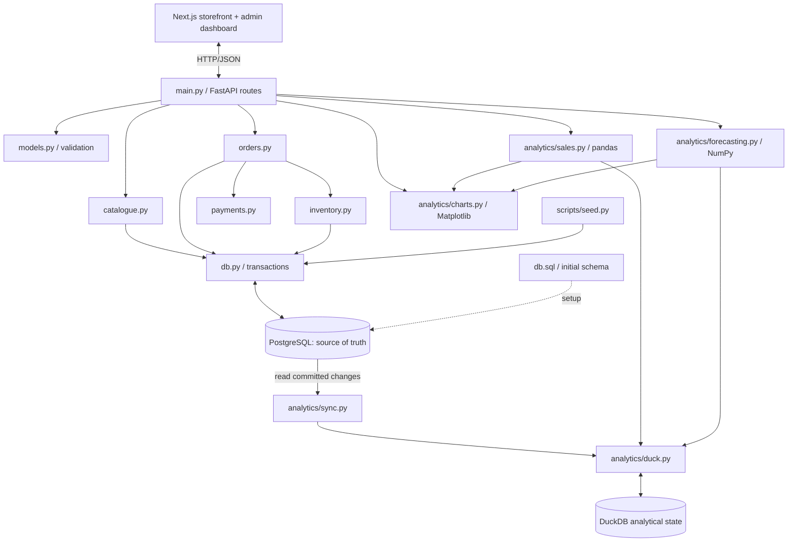

### PROJECT SUMMARY 

**CommerceLab**, an all-in-one e-commerce system with a seeded, functioning storefront that can evolve towards a real business without rewriting the core domain logic. The goal is not to collect frameworks: it is to demonstrate design decisions, controlled experiments, invariants, failure handling and tests.

The application should support:

- Product catalogue and storefront, carts and checkout
- Orders, inventory, simulated payments, refunds and stock movements
- An operational **PostgreSQL** database as the sole source of truth
- A **DuckDB** analytical component for read-only consumption of operational data and heavier analytics
- **pandas** for analysis, **NumPy** for simulation/forecasting, **Matplotlib** for visualisation
- A Next.js/React frontend talking to a Python/FastAPI backend
- Deterministic seeded data and tests that prove correctness
- A possible future AI assistant using function/tool calling (provider/framework not yet selected)

**Learning objective:** build the system largely in Python to practise functions, loops, conditionals, modules, exceptions, SQL, pandas, NumPy, Matplotlib, tests and system design — and be able to explain why every significant component exists.

## Architectural principles

1. **Modular monolith:** one Python backend with logical modules, not microservices by default.
2. **Thin `main.py`:** initialise/register the API; no business logic or ad hoc SQL inside it.
3. **Clear ownership:** order rules in `orders.py`, stock rules in `inventory.py`, connections/transactions in `db.py`, analytics in `analytics/`.
4. **One operational source of truth:** PostgreSQL owns customers, products, orders, payments, stock and refunds. DuckDB never writes operational records back into PostgreSQL.
5. **Analytical freshness is explicit:** live Postgres queries and cached DuckDB reports must not be confused. A read-only DuckDB-to-Postgres connection does *not* guarantee a persisted DuckDB copy is current.
6. **Incremental work where justified:** update only affected analytical records/partitions, with durable checkpoints, replay safety and reconciliation.
7. **Tests before claims:** every interesting engineering choice gets an invariant, a test scenario and a measurable result.
8. **Keep the initial implementation understandable:** no Kafka, Redis, Kubernetes, extra services or abstractions without a concrete need.
9. **Demo/live separation:** seeded data, fake payments and development users isolated from real environments.

## Architecture Diagram

## Decisions still to settle

- [ ]  Exact table DDL, monetary amounts, tax and refund accounting definitions
- [ ]  ORM versus direct SQL for backend access (keep one approach consistent)
- [ ]  Specific checkout API, and whether inventory reservations expire
- [ ]  DuckDB storage mode: live Postgres queries, persisted snapshots or hybrid; thresholds for caching
- [ ]  Safe change-capture mechanism and checkpoint order (avoid losing late-committing changes)
- [ ]  Whether the storefront is built alongside or immediately after core order logic
- [ ]  API chart format (JSON chart data versus generated PNG/SVG)
- [ ]  Authentication, deployment provider, real payment integrations (deferred)