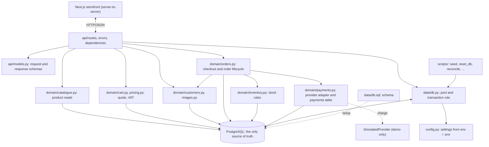
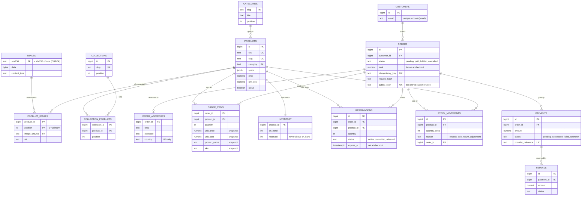
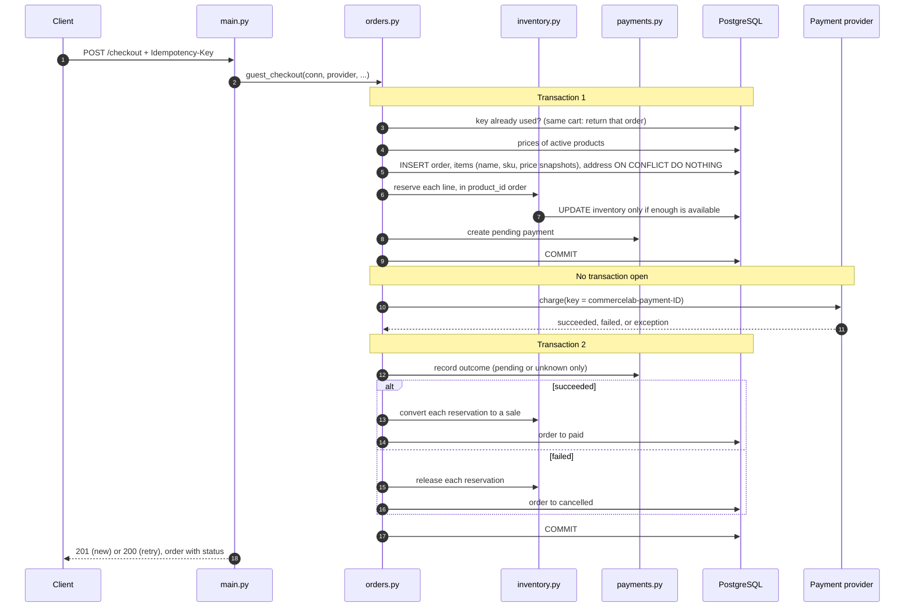

# CommerceLab architecture

How the system is built today, why it is built that way, and what is still
planned. The original plan lives in the README and the Notion handover; this
document records what actually exists, and where the build differs from the plan.

**Status (23 November 2026):** the backend (checkout, reservation expiry,
reconciliation, the storefront's catalogue, cart quote, images and order routes)
and the Next.js storefront (`frontend/`: home, listing, product, bag, one-page
checkout, order page) are built and merged on the `storefront` branch. Refunds,
fulfilment, accounts and analytics are not built. Section 7 covers the storefront.

---

## 1. Shape of the system

A modular monolith: one Python process, one PostgreSQL database, modules with
clear ownership. No queues, caches or extra services.



Arrows show who calls whom. Domain modules never open connections: a route
borrows one through `db.get_conn` and passes it down, so every module in a
request shares that request's connection and transactions.

### Layout

```
commercelab/              the application package
├── config.py
├── main.py               assembles the app: startup, routers, error handlers
├── api/                  HTTP layer: no SQL, no business rules
│   ├── dependencies.py
│   ├── errors.py
│   ├── models.py
│   └── routes/           health, products, collections, cart, images, orders
├── domain/               business rules: catalogue, pricing, cart, customers,
│                         images, inventory, orders, payments
└── data/                 db.py, db.sql
scripts/                  seed, reset_db, reconcile, export_openapi, fetch_images
                          (run with python -m scripts.<name>)
tests/                    api/, domain/, data/, scripts/, support/ (shared helpers)
frontend/                 the Next.js storefront (section 7)
openapi.json              the API contract, generated (section 6)
docs/
```

Imports are always absolute from the package (`from commercelab.domain import
orders`), so no module name can collide with an installed library. Dependencies
point one way: `api` depends on `domain` and `data`; `domain` depends on `data`
only through the connection it is handed; nothing depends on `api`.

### Files

All paths are inside `commercelab/` unless they start with `scripts/`.

| File | Owns | Depends on |
|---|---|---|
| `main.py` | App startup and shutdown: opens the pool, registers error handlers, includes routers. | `api`, `data.db` |
| `api/routes/*.py` | One router per area. Each route validates input, calls one domain function, returns a response model. | `api.dependencies`, `domain` |
| `api/dependencies.py` | `Conn` and `Provider`: what routes receive. The shared demo payment provider. | `data.db`, `domain.payments` |
| `api/errors.py` | Domain exception to HTTP status, in one table. | `domain` |
| `api/models.py` | The public JSON contract. | Pydantic |
| `domain/catalogue.py` | What the storefront may see: active products only, never `unit_cost`, and product responses show stock bands rather than the raw `available` count. Filtering, sorting, facets, collections, stock bands. Read-only. | `product_availability` view |
| `domain/pricing.py` | `vat_included()`, the delivery constant, the penny rule. | |
| `domain/cart.py` | `quote()`: prices a browser cart against the database. Read-only, reserves nothing. | `catalogue`, `pricing` |
| `domain/customers.py` | `find_or_create` a customer by email; the `Contact` and `DeliveryAddress` shapes. | |
| `domain/images.py` | Reads image bytes by sha256 key. Read-only. | |
| `domain/orders.py` | Order rules: all-or-nothing orders, prices and names from the DB, idempotent retries, status transitions, the public token and `CL-` reference, guest checkout, reconciliation. Orchestrates the modules above. | `inventory`, `payments`, `customers`, `pricing` |
| `domain/inventory.py` | Stock rules: never hold more than is available; settle each reservation exactly once; record every change to `on_hand`. | |
| `domain/payments.py` | The `PaymentProvider` interface, `SimulatedProvider`, and writes to the `payments` table. | |
| `data/db.py` | Connection pool, `get_conn` dependency, standalone `connect()` for scripts, the transaction rule. | `config` |
| `data/db.sql` | Tables, constraints, indexes, the `product_availability` view. Dev script: drops and recreates. | |
| `config.py` | Settings (`DATABASE_URL`, `APP_ENV`, pool size, hold length, `SIMULATED_DECLINE_PERCENT`) with validation at import. | pydantic-settings |
| `scripts/seed.py` | Deterministic demo data (seed 42): same seed, byte-identical rows. Refuses to run unless `APP_ENV=demo`. | `data.db` |
| `scripts/reset_db.py`, `fetch_images.py`, `export_openapi.py` | See section 8. | |
| `scripts/reconcile.py` | Resolves orders left pending (see section 5). Safe to run repeatedly; `--dry-run` lists candidates. Demo only until a live provider exists. | `domain.orders`, `domain.payments` |

---

## 2. Data model



### What the storefront added, and why it lives in PostgreSQL

| Table | Holds | Why it is here |
|---|---|---|
| `categories`, `collections`, `collection_products` | Navigation order, titles and descriptions; hand-ordered merchandising sets ("spotlight", "featured") | Shop content is data the API serves, not copy hard-coded in the frontend |
| `products` (new columns) | `slug`, `brand`, `category`, `tagline`, `description`, `specs` (JSONB array with a CHECK) | The product page renders from one query |
| `images`, `product_images` | Image bytes, their content type and licence/credit, and each product's ordered gallery | See below |
| `order_items.product_name`, `sku` | Snapshots, beside the existing price and cost snapshots | Renaming or deleting-from-sale a product never rewrites a past order |
| `order_addresses` | The delivery address as typed at checkout, one per order | Copied, not referenced, like prices: an order keeps what was true when it was placed. Seeded historical orders have none |
| `orders.public_token` | A random 32-hex id with a UNIQUE constraint | The only way a customer reaches an order (section 6) |

**Images are in PostgreSQL, content-addressed.** The primary key is the sha256
of the bytes, and a CHECK (`sha256 = encode(sha256(data), 'hex')`, built-in
function, no extension) makes the database prove it. A key therefore always
names the same bytes, so `GET /images/{key}` is immutable and cacheable forever
(`Cache-Control: public, max-age=31536000, immutable`, `ETag` = the key, 304 on a
matching `If-None-Match` without touching the table). It also keeps the rule
"PostgreSQL is the single source of truth" free of an exception: no file store
to back up or keep in step. The stock photos' source, licence and credit are
stored with them, though the public API does not expose credits.

### Conventions

- **Money:** `NUMERIC(12,2)` in Postgres, `Decimal` in Python, a JSON **string**
  over HTTP (`"97.90"`). Single currency (GBP), prices tax-inclusive. Never floats.
- **Statuses:** `TEXT` with a named `CHECK (status IN (...))`, easier to read
  and change than Postgres enums.
- **Ids:** `BIGINT GENERATED ALWAYS AS IDENTITY`. Rolled-back inserts leave gaps;
  that is normal.
- **Timestamps:** `TIMESTAMPTZ`, UTC.
- **Products are deactivated, never deleted.** Foreign keys block deletion of
  anything with history.

### Two sources of stock truth, kept in agreement

`inventory` holds the current numbers (fast to read and lock). `stock_movements`
is the append-only audit log. Every function in `inventory.py` writes both in
one transaction, and tests check that `on_hand` always equals the sum of
movements. Reserving does **not** create a movement: held stock hasn't left.

### The single definition of "available"

```sql
CREATE VIEW product_availability AS
SELECT product_id, on_hand, reserved, on_hand - reserved AS available FROM inventory;
```

Catalogue reads this view instead of repeating the arithmetic, so a future
change (such as ignoring expired reservations) happens in one place.
`inventory.reserve()` repeats `on_hand - reserved` inside its `UPDATE`, because
the check must be part of the locked statement (see section 4).

---

## 3. The transaction rule

Every connection from `data/db.py` runs in **autocommit** mode, and anything that
must be atomic is wrapped explicitly:

```python
with conn.transaction():
    ...  # all of this commits together, or none of it does
```

**Why autocommit.** Without it, psycopg opens a transaction implicitly at the
first statement, and a later `conn.transaction()` becomes only a savepoint
inside it. Checkout would believe it had committed the stock reservation before
calling the payment provider when it had merely released a savepoint. With
autocommit, a top-level `conn.transaction()` is always a real `BEGIN ... COMMIT`.

**Nesting.** Each domain function opens its own `conn.transaction()`. Called
inside a caller's block (orders reserving each line of a checkout), that becomes
a savepoint, so one failed line rolls back the whole order.

**In tests.** The `conn` fixture hands over a connection already inside an
outer transaction opened with `force_rollback=True`. Every block inside it is a
savepoint, and everything is undone when the test ends. The outer block must be
opened up front: on an idle connection, `conn.transaction()` starts and
**commits** a real transaction. That bug existed in the first version of the
fixture and is now pinned by a test.

---

## 4. Concurrency: check inside the change

The core technique, used in four places: **a rule is checked inside the same
`UPDATE` (or `INSERT`) that acts on it, never in a separate read beforehand.**

```sql
-- inventory.reserve()
UPDATE inventory SET reserved = reserved + %(q)s
WHERE product_id = %(p)s AND on_hand - reserved >= %(q)s
RETURNING product_id          -- no row returned = not enough stock
```

Postgres locks the row while the statement runs. A concurrent statement on the
same row waits, then re-evaluates its `WHERE` against the committed result. A
separate "read available, then update" lets two checkouts both pass the check
before either takes stock. This was demonstrated, not assumed: written that way,
the race tests failed, with only the `reserved <= on_hand` constraint
preventing an oversell.

| Where | The check inside the change | Prevents |
|---|---|---|
| `inventory.reserve` | `AND on_hand - reserved >= q` | Overselling the last units |
| `inventory.release`, `convert_to_sale` | `AND status = 'active'` | A reservation being both sold and released |
| `payments.record_outcome` | `AND status IN ('pending', 'unknown')` | Two retries both settling one payment |
| `orders.place_order` | `INSERT ... ON CONFLICT (idempotency_key) DO NOTHING` | A double-click creating two orders |

**Lock order.** Checkout reserves lines in `product_id` order. Two checkouts that
locked the same products in opposite orders could deadlock.

**The constraints are the last line of defence**, not the mechanism. If a bug
bypassed `inventory.py`, `CHECK (reserved <= on_hand)` would still refuse the
write, as a raw database error instead of a clean `InsufficientStock`.

---

## 5. Checkout



### Guest checkout

There are no accounts. `POST /checkout` takes `contact`, `address` and `items`
(no prices, no customer id). `orders.guest_checkout` first calls
`customers.find_or_create`, an `INSERT ... ON CONFLICT ((lower(email))) DO
NOTHING` followed by a select, so the same email in any letter case is one
customer, two first-time checkouts with one new email still make one row, and an
existing customer's name and phone are never overwritten. It then runs the
checkout above, with the address copied onto the order.

The customer row is committed on its own, **before** the order. A refused
checkout (not enough stock, an unknown or discontinued product, an idempotency
conflict) can therefore leave a customer with no order. That is harmless: the
next checkout with that email reuses the row. It is deliberate, not a leak.

The response is the order: `status`, a `reference` (`CL-` plus the id padded to
five digits, `CL-00007`), the `public_token`, item snapshots, totals and the
address. 201 means this request created it, 200 a retry.

### Why two transactions around the payment call

A remote payment call can take seconds. Holding the reservation's row locks
that long would block every other checkout for the same products. So
transaction 1 commits the order, its reservations and a pending payment
**before** the provider is called.

### Failure handling

| What happens | Result | How it recovers |
|---|---|---|
| Not enough stock on any line | `InsufficientStock` (HTTP 409); transaction 1 rolls back, so nothing is created and the provider is never called | The key stays unused; the same checkout can be retried later |
| Provider declines | Order `cancelled`, payment `failed`, stock released | Terminal. A new attempt needs a new key. The simulated provider declines `SIMULATED_DECLINE_PERCENT` of payments (default 5), decided from the key |
| Provider raises (timeout, network) | Payment `unknown`, order `pending`, **stock stays held**: the customer may have been charged | Retry with the same key re-asks the provider; otherwise reconciliation |
| Process crashes after transaction 1 | Order `pending`, payment `pending` | Retry with the same key resumes at the payment step; otherwise reconciliation after the hold expires |
| Same key, same cart | The original order, HTTP 200, no new charge | |
| Same key, different cart | `IdempotencyConflict` (HTTP 409), nothing changed | |

Retrying the payment step is safe because the provider is called with a key that
is stable for that payment, and providers charge at most once per key. The
simulated provider guarantees this by deriving the outcome from the key.

### Expiry and reconciliation

Checkout holds stock for `RESERVATION_HOLD_MINUTES` (default 15), stored as
`reservations.expires_at = now() + hold` on the database's clock. Expiry
releases nothing by itself: an expired hold still counts against stock until
`orders.reconcile` (run by `scripts/reconcile.py`) resolves the order.

Reconciliation looks at pending orders whose payment is `unknown` or whose hold
has expired, and asks the provider with `lookup()`, which reports what happened
to a key **without charging**. (Calling `charge()` again would bill an abandoned
cart long after the customer left.)

| Provider says | Result |
|---|---|
| Charged, succeeded | Order `paid`, stock sold, even if the hold had expired: the customer paid |
| Charged, declined | Order `cancelled`, stock released |
| Never charged, hold expired | Order `cancelled`, payment `failed` with no provider reference, stock released |
| Never charged, hold still running | Unchanged; the customer may still retry |
| No answer (unreachable) | Unchanged, however long ago the hold expired. Releasing stock the customer may have paid for is worse than holding it longer |

Every settlement goes through `payments.record_outcome`'s status-checked
`UPDATE`, so reconciliation is safe to run repeatedly, concurrently with itself,
and alongside customer retries.

**Known gap:** if a customer retry is charging at the moment reconciliation
cancels that order, the charge can succeed on a cancelled order. The database
stays consistent (only one settlement is recorded), but the money needs a
refund, which isn't built yet.

**Demo limitation:** `SimulatedProvider` remembers its charges in memory only.
The API shares one instance across requests, but `scripts/reconcile.py` runs in
its own process with a fresh one, so there it can only answer "never charged".

### HTTP errors

| Status | Meaning | Raised as |
|---|---|---|
| 404 | The thing in the URL doesn't exist | `ProductNotFound`, `OrderNotFound` |
| 409 | Conflicts with current state | `InsufficientStock` (with `product_id`, `requested`, `available`), `IdempotencyConflict` |
| 422 | Malformed request, or the body refers to something invalid | Pydantic validation (email, UK postcode, phone, 1 to 100 per line, 1 to 50 lines), `ProductUnavailable` |
| 503 | Dependency unavailable | `/health` when Postgres is down; checkout when `APP_ENV=live` (no real provider) |

---

## 6. API

| Route | Returns |
|---|---|
| `GET /health` | `{"status", "database"}`; 503 if Postgres is unreachable |
| `GET /products?category=&brand=&min_price=&max_price=&in_stock=&sort=&limit=&offset=` | `{"items", "total", "limit", "offset", "facets"}`. `brand` repeats. `sort` is `featured`, `name`, `price_asc` or `price_desc`, each with an id tie-break and `COLLATE "C"` for names, so order is identical on every server. An offset past the end is a 200 with no items and the true total. `min_price > max_price` is a 422 |
| `GET /products/by-slug/{slug}` | One active product with description and specs |
| `GET /products/{id}` | One active product card |
| `GET /categories` | Categories with at least one active product, in nav order |
| `GET /collections`, `GET /collections/{slug}` | Hand-ordered sets and their product cards |
| `POST /cart/quote` | Prices a cart (section 6.1). Never a 422 for a stale cart |
| `POST /checkout` | Guest checkout (section 5). Requires an `Idempotency-Key` header |
| `GET /orders/{token}` | The order with items, address and payment-derived status, by its unguessable token. No unit costs |
| `GET /images/{key}` | Image bytes, immutable and cacheable (section 2) |

**`GET /orders/{id}` (by numeric id) was removed.** A numeric route would let
anyone browse other customers' orders by counting. The token is the only handle,
and the numeric id is never in a response.

**The contract is a file.** `openapi.json` at the repo root is generated by
`scripts/export_openapi.py` (sorted keys, 2-space indent). The frontend generates
its TypeScript types from it. `tests/api/test_openapi_export.py` fails while the
committed file differs from what the app would emit, so a change to
`api/models.py` or a route cannot ship without regenerating it (section 7).

Interactive documentation is generated at `/docs` when the server runs
(`uv run uvicorn commercelab.main:app --reload`).

**Customer identity is not authenticated.** A guest names themselves by email;
nothing proves who they are, and an order is protected only by its token. Real
authentication (Phase 5) must come from the session.

### 6.1 Rules computed in Python

Every number the shopper sees is computed in `commercelab/domain/`. The frontend
renders them.

| Rule | Where | Detail |
|---|---|---|
| **VAT** | `pricing.vat_included` | Prices are tax-inclusive at 20%. VAT is read out of the gross, never added: `gross x 0.20 / 1.20`, which is gross divided by 6, rounded half up to the penny (119.00 gives 19.83, 417.00 gives 69.50). Shown as "Includes VAT" |
| **Delivery** | `pricing.STANDARD_DELIVERY` | One option, free, on every quote and order |
| **Stock bands** | `catalogue.stock_band` | 0 is `out_of_stock`, 1 to 5 is `low_stock` with `stock_left` set, 6 or more is `in_stock`. Product responses carry only the band. The 409 stock error and the cart quote do reveal how many can be bought (up to 100), by design |
| **Quote clamping** | `cart.quote` | Repeated ids merge (first-seen order). Each line's quantity is `min(requested, available, 100)`, 0 when sold out, with `limited: true` whenever it was reduced. Unknown and inactive ids go to `removed`. Nothing is reserved |
| **Order reference** | `orders.order_reference` | `CL-%05d` of the order id. Shown to customers beside, never instead of, the token |
| **Seed repricing** | `scripts/seed.py` | Five non-scenario products are raised 10% part-way through the simulated history, rounded to **whole pounds** like every catalogue price, so a shopper never sees an odd-pence price. Earlier order items keep the old price (the snapshot) |
| **Sorting** | `catalogue` | `COLLATE "C"` plus the id, so results don't depend on the server's locale |
---

## 7. Storefront

`frontend/` is a Next.js (App Router) app. It is a thin renderer over the API:
no business rules, no database access, no second source of truth.

```
browser  --pages, /api/*, /media/*-->  Next.js server  --server-to-server-->  FastAPI  -->  PostgreSQL
```

- **Server components fetch the backend directly.** Listing, product, home and
  order pages call FastAPI from the Next.js server through `lib/api.ts`
  (`cache: "no-store"`: stock and prices change between requests). The module
  imports `server-only`, so importing it from a client component is a build error.
- **The backend URL never reaches the browser.** `API_URL` (default
  `http://127.0.0.1:8000`) is read on the server only. The browser talks to
  Next.js alone, through three route handlers that proxy and pass the status and
  body back unchanged: `POST /api/cart/quote`, `POST /api/checkout` (with the
  `Idempotency-Key` header) and `GET /media/[key]` (to `/images/{key}`, passing
  `If-None-Match`, `Cache-Control` and `ETag`, so the immutable caching survives).
  An unreachable backend becomes `502 {"detail": "upstream unavailable"}`; a
  failing server component shows `app/error.tsx`, and a backend 404 shows the
  app's 404 page.
- **Generated types.** `lib/api-types.ts` is generated from `openapi.json` by
  `npm run gen:api`. `npm run typecheck` regenerates it and fails if the committed
  file changed, so a stale contract is caught from both ends.
- **Routes.** `/` home, `/c/[category]` listing (filters live in the URL),
  `/p/[slug]` product, `/checkout`, `/orders/[token]`, plus content pages
  (delivery and returns, contact, terms, privacy).

### The bag

The cart is `(product_id, quantity)` lines in `localStorage`
(`commercelab.cart.v1`), read once after mount and parsed defensively: bad JSON
or bad entries give an empty or cleaned bag, never a crash. Bounds mirror the
server (1 to 100 per line, 50 lines), and the server enforces them again.
**Every number on screen comes from `POST /cart/quote`**: prices, line totals,
what can really be bought, VAT, total. The frontend never adds or multiplies
money.

### Checkout and retry safety

The checkout is one page. Card fields are not named inputs and never leave the
browser; the request body holds contact, address and bag lines only.

| Situation | What the page does |
|---|---|
| Same body again (double click, retry, reload) | Reuses the stored `Idempotency-Key`. The backend returns the existing order, never a second charge |
| Changed body | A new key (the backend refuses a key reused for a different body) |
| Declined (order `cancelled`) | A new key: a declined order is cancelled for good |
| Outcome unknown (no answer, or status `pending`) | The attempt is marked uncertain in `sessionStorage` (`commercelab.checkout-attempt.v1`) with its **full request body**. The form locks, and Pay re-sends that stored body with that key, even after a reload. Pending orders are re-checked at 2, 4 and 8 seconds, then "Check again now" |
| Stuck with no order named | "Start a new order" clears the attempt, with a warning that ordering again could duplicate a payment that did go through |
| Stock or validation answer (409, 422) | The key stays; the bag is re-quoted and the warning shown |

Pay stays disabled until the shopper has seen a total that matches the current
lines (not while quoting, not on a failed quote, not with a sold-out line). The
locked summary is priced from the stored request, not from whatever the bag
holds now. A paid order clears the attempt and the bag and redirects to
`/orders/{token}`. Storage failures degrade to memory: the key holds for the
page but not across a reload.

**Known gaps.** `sessionStorage` is per tab, so an uncertain attempt is not seen
from another tab. The declined and pending flows are tested against mocked first
responses, because the simulated provider can't be made to decline or time out on
demand at 0%.

### Deliberately not built

Accounts and sign-in, order history, search, reviews and wishlists, discount
codes, multiple currencies or countries (UK only), real payments, confirmation
emails and delivery dates (the shop promises only what the system does), and
polling on the order page (it shows the status on load; pending orders refresh
by reloading). Photo credits are stored but not displayed.
---

## 8. Demo and live separation, and the scripts

`APP_ENV` is `demo` or `live` (anything else fails at startup).

- `scripts/seed.py` refuses to run unless `demo`, before opening any connection.
- The simulated payment provider exists only in `demo`; in `live`, checkout
  returns 503 until a real provider is written.
- Tests never touch the dev database: they refuse to run unless the database
  name ends in `_test`.

| Script | What it does |
|---|---|
| `scripts.fetch_images` | Downloads the stock photos in `scripts/image_manifest.json` into `.cache/images/<sha256>` (git-ignored), verifying each hash. Resumable: cached files that still hash correctly are skipped. A hash mismatch or failed download exits non-zero naming the product |
| `scripts.reset_db` | Checks every manifest image is cached (before touching anything), creates the database if missing, applies `db.sql`, and loads seed 42 with the image bytes in one transaction. **Refuses** unless `APP_ENV=demo` and the database is named `commercelab` or ends in `_e2e`; it never touches `_test` or any other name |
| `scripts.export_openapi` | Writes `openapi.json` (section 6). Re-run after any change to `api/models.py` or a route |
| `scripts.seed` | The seed itself (library for `reset_db`; also runnable on its own) |
| `scripts.reconcile` | Resolves pending orders (section 5); `--dry-run` lists them |

---

## 9. Testing

```
uv run pytest -q         # 357 tests, about 10 seconds
uv run pytest -m concurrency
```

Frontend, from `frontend/`:

```
npm test                 # 101 unit tests (vitest, 10 files)
npm run typecheck        # regenerates api-types.ts, fails if it changed, then tsc
npm run lint
npm run e2e              # 91 Playwright tests, two projects, against the real backend
```

Tests run against `commercelab_test` (created if missing, schema rebuilt from
`commercelab/data/db.sql` each run). Fixtures in `tests/conftest.py`:

| Fixture | Gives | Use for |
|---|---|---|
| `conn` | A connection inside a transaction that always rolls back | Almost every test |
| `seeded` | The seed-42 dataset inside that transaction | Tests that need realistic data |
| `client` | A FastAPI test client whose routes use `conn` | HTTP tests |
| `committed_db` | Real commits; wipes all tables afterwards | Proving a commit, or that another connection sees it |
| `pool` | The app's pool opened against the test database | Pool and health tests |

**Shared invariants** (`tests/support/invariants.py`) are rules that span tables, so no
`CHECK` can enforce them: order totals match their items, `on_hand` matches the
movement ledger, `reserved` matches active reservations, refunds never exceed
the payment, paid orders have exactly one successful payment, and unpaid orders
have taken no stock. Domain tests assert all of them after every checkout.

**Race tests** use real committed transactions on separate connections. The
two-connection tests force the worst-case interleaving: the second connection
is allowed to proceed only once `pg_stat_activity` shows it waiting on the
first one's lock, and the test fails if it never waits (so it can't pass
without actually racing).

**Tests were checked to fail.** Key mechanisms were deliberately broken one at a
time (a plain `INSERT` instead of `ON CONFLICT`, a timeout recorded as `failed`,
the provider called inside the open transaction, retries reported as new), and
each was caught by its intended tests.

| File | Tests | Covers |
|---|---|---|
| `data/test_schema.py` | 50 | Every constraint rejects what it should, by name, and accepts valid rows (including the image hash CHECK) |
| `data/test_db.py` | 12 | Pool lifecycle, the transaction rule, savepoint isolation |
| `domain/test_catalogue.py` | 62 | Visibility, filters, facets, sorting, paging, stock bands, collections, injection safety |
| `domain/test_inventory.py` | 21 | Reserve, release, sale, restock, three race tests |
| `domain/test_orders.py` | 35 | Checkout outcomes, idempotency, guest checkout, crash recovery, two race tests |
| `domain/test_reconcile.py` | 19 | Hold expiry, every reconciliation outcome, concurrent reconcilers, the script |
| `domain/test_cart.py`, `test_pricing.py`, `test_customers.py`, `test_images.py` | 9, 7, 5, 2 | Quote clamping, VAT rounding, find-or-create under concurrency, image reads |
| `api/test_catalogue_routes.py` | 31 | HTTP contract for health, products, categories, collections |
| `api/test_order_routes.py` | 24 | HTTP contract for checkout and the token route |
| `api/test_cart_routes.py`, `test_image_routes.py`, `test_dependencies.py` | 3, 12, 1 | Quote route, image caching and 304s, the provider dependency |
| `api/test_openapi_export.py` | 1 | `openapi.json` matches the app |
| `scripts/test_seed.py` | 33 | Determinism, the demo-only guard, invariants on seeded data |
| `scripts/test_reset_db.py`, `test_image_manifest.py`, `test_catalogue_data.py` | 7, 14, 9 | What `reset_db` refuses, the manifest, catalogue content |

**Frontend tests.** The unit tests cover the pure logic: cart parsing, money
formatting, listing URL parameters, the checkout schema, attempt keys, outcome
mapping and the re-check schedule. The Playwright suite (`frontend/e2e/`) drives
the real backend against its own database (`reset_db` runs first; the simulated
decline rate is set to 0 so nothing depends on chance). A second project runs the
same build against a backend that isn't there, to prove the error pages. The
checkout tests include the worst case: the real backend creates and charges the
order, then the response is dropped before the browser sees it, and the test
counts rows in `orders` and `payments` to prove a retry or reload made no second
order. Declined and pending outcomes are mocked on the first response only.

---

## 10. Where the build differs from the plan

| Plan (README, Notion) | Built | Why |
|---|---|---|
| Flat files at the repo root; split into packages "only when growth justifies it" | One `commercelab` package with `api/`, `domain/`, `data/`; routes split out of `main.py` | Reorganised once routes, domain modules and tests had grown enough to need grouping. The plan named this as the likely evolution |
| ORM or direct SQL: undecided | Direct SQL with psycopg 3 | Keeps SQL visible, which is a learning goal |
| Stock check location: open | In `inventory.reserve`, inside the `UPDATE` | A check in `orders.py` before reserving is a race (section 4) |
| Storefront alongside or after core order logic: open | After | Build the UI against a stable API |
| `POST /checkout` takes `customer_id`, and `GET /orders/{id}` reads an order | Guest checkout (`contact` + `address`) and `GET /orders/{token}`; the numeric route is gone | The storefront has no accounts, and a numeric route lets anyone browse orders |
| Images as files or an object store | Bytes in PostgreSQL, keyed by sha256 | One source of truth; the key proves the bytes, so they cache forever |
| Phases 0 to 1 in Docker sandboxes; later phases in cloud sessions | Phases 0 to 1 in Docker; the frontend streams were built natively on the Mac | The Docker disk failed under load and the cloud route couldn't be launched. The finished app is packaged separately with Compose |
| Analytics outbox and checkpoint tables in the initial schema | Deferred | The checkpoint design needs its own discussion; it doesn't block checkout |

---

## 11. Not built yet

- **Fulfilment** (`paid -> fulfilled`), **customer cancellation**, **refunds**.
  Refunds also close the reconciliation gap in section 5.
- **Scheduling reconciliation.** `scripts/reconcile.py` must be run by hand or
  from cron; nothing runs it automatically.
- **Customer accounts, order history and search** in the storefront.
- **Analytics** (Phase 3): metric definitions, pandas reports, Matplotlib
  charts, DuckDB, incremental sync.
- **Migrations.** `commercelab/data/db.sql` drops and recreates everything; versioned
  migrations are needed before any data must survive a schema change.
- **Authentication, a real payment provider, tax and shipping** (Phase 5).

## 12. Local Compose runtime

`compose.yaml` packages the native request path as three services. The browser
uses Next.js on loopback port 3000. The Next.js standalone server calls
`http://api:8000`; FastAPI also publishes port 8000 on loopback for direct use.
Only the API connects to `db:5432`. PostgreSQL stores the shop and its photos
on the project's named volume. The retired development sandbox plays no role.

PostgreSQL readiness gates the API's read-only schema preflight. Missing tables
or the availability view stop startup and produce restore guidance. Once
Uvicorn serves `/health`, Compose starts the web service. Database preparation
happens once, through the [verified transfer procedure](../README.md#first-transfer-from-native-postgresql-17).
An ordinary stop or container recreation reuses the restored database.

Each service has a one-CPU runtime limit. PostgreSQL has 1 GiB of memory,
and FastAPI and Next.js each have 512 MiB. The smoke script samples actual
usage after checkout and reopens the same purchased order after recreation.
