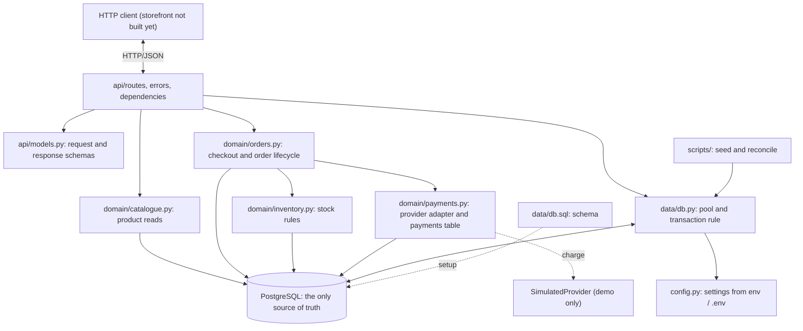
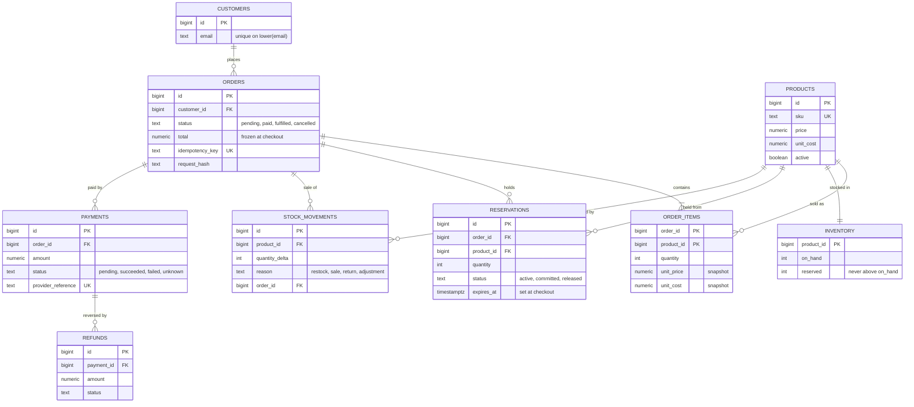
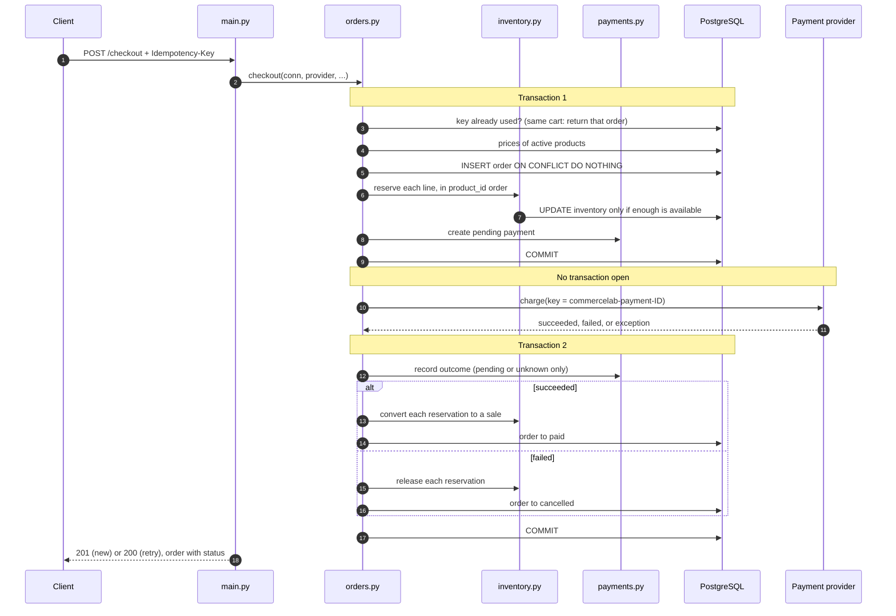

# CommerceLab architecture

How the system is built today, why it is built that way, and what is still
planned. The original plan lives in the README and the Notion handover; this
document records what actually exists, and where the build differs from the plan.

**Status (21 November 2026):** Phase 1 (foundation) complete. Phase 2 (commerce)
backend complete for checkout, reservation expiry and reconciliation; refunds,
fulfilment and the storefront are not built. No analytics yet.

---

## 1. Shape of the system

A modular monolith: one Python process, one PostgreSQL database, modules with
clear ownership. No queues, caches or extra services.



Arrows show who calls whom. Domain modules never open connections: a route
borrows one through `db.get_conn` and passes it down, so every module in a
request shares that request's connection and transactions.

### Layout

```
commercelab/              the application package
├── config.py
├── main.py               assembles the app: startup, routers, error handlers
├── api/                  HTTP layer: no SQL, no business rules
│   ├── dependencies.py
│   ├── errors.py
│   ├── models.py
│   └── routes/           health.py, products.py, orders.py
├── domain/               business rules: catalogue, inventory, orders, payments
└── data/                 db.py, db.sql
scripts/                  seed.py, reconcile.py   (run with python -m scripts.<name>)
tests/                    api/, domain/, data/, scripts/, support/ (shared helpers)
docs/
```

Imports are always absolute from the package (`from commercelab.domain import
orders`), so no module name can collide with an installed library. Dependencies
point one way: `api` depends on `domain` and `data`; `domain` depends on `data`
only through the connection it is handed; nothing depends on `api`.

### Files

All paths are inside `commercelab/` unless they start with `scripts/`.

| File | Owns | Depends on |
|---|---|---|
| `main.py` | App startup and shutdown: opens the pool, registers error handlers, includes routers. | `api`, `data.db` |
| `api/routes/*.py` | One router per area. Each route validates input, calls one domain function, returns a response model. | `api.dependencies`, `domain` |
| `api/dependencies.py` | `Conn` and `Provider`: what routes receive. The shared demo payment provider. | `data.db`, `domain.payments` |
| `api/errors.py` | Domain exception to HTTP status, in one table. | `domain` |
| `api/models.py` | The public JSON contract. | Pydantic |
| `domain/catalogue.py` | What the storefront may see: active products only, never `unit_cost`. Read-only. | `product_availability` view |
| `domain/orders.py` | Order rules: all-or-nothing orders, prices from the DB, idempotent retries, status transitions, reconciliation. Orchestrates inventory and payments. | `inventory`, `payments` |
| `domain/inventory.py` | Stock rules: never hold more than is available; settle each reservation exactly once; record every change to `on_hand`. | |
| `domain/payments.py` | The `PaymentProvider` interface, `SimulatedProvider`, and writes to the `payments` table. | |
| `data/db.py` | Connection pool, `get_conn` dependency, standalone `connect()` for scripts, the transaction rule. | `config` |
| `data/db.sql` | Tables, constraints, indexes, the `product_availability` view. Dev script: drops and recreates. | |
| `config.py` | Settings (`DATABASE_URL`, `APP_ENV`, pool size, hold length) with validation at import. | pydantic-settings |
| `scripts/seed.py` | Deterministic demo data: same seed, byte-identical rows. Refuses to run unless `APP_ENV=demo`. | `data.db` |
| `scripts/reconcile.py` | Resolves orders left pending (see section 5). Safe to run repeatedly; `--dry-run` lists candidates. Demo only until a live provider exists. | `domain.orders`, `domain.payments` |

---

## 2. Data model



### Conventions

- **Money:** `NUMERIC(12,2)` in Postgres, `Decimal` in Python, a JSON **string**
  over HTTP (`"97.90"`). Single currency (GBP), prices tax-inclusive. Never floats.
- **Statuses:** `TEXT` with a named `CHECK (status IN (...))`, easier to read
  and change than Postgres enums.
- **Ids:** `BIGINT GENERATED ALWAYS AS IDENTITY`. Rolled-back inserts leave gaps;
  that is normal.
- **Timestamps:** `TIMESTAMPTZ`, UTC.
- **Products are deactivated, never deleted.** Foreign keys block deletion of
  anything with history.

### Two sources of stock truth, kept in agreement

`inventory` holds the current numbers (fast to read and lock). `stock_movements`
is the append-only audit log. Every function in `inventory.py` writes both in
one transaction, and tests check that `on_hand` always equals the sum of
movements. Reserving does **not** create a movement: held stock hasn't left.

### The single definition of "available"

```sql
CREATE VIEW product_availability AS
SELECT product_id, on_hand, reserved, on_hand - reserved AS available FROM inventory;
```

Catalogue reads this view instead of repeating the arithmetic, so a future
change (such as ignoring expired reservations) happens in one place.
`inventory.reserve()` repeats `on_hand - reserved` inside its `UPDATE`, because
the check must be part of the locked statement (see section 4).

---

## 3. The transaction rule

Every connection from `data/db.py` runs in **autocommit** mode, and anything that
must be atomic is wrapped explicitly:

```python
with conn.transaction():
    ...  # all of this commits together, or none of it does
```

**Why autocommit.** Without it, psycopg opens a transaction implicitly at the
first statement, and a later `conn.transaction()` becomes only a savepoint
inside it. Checkout would believe it had committed the stock reservation before
calling the payment provider when it had merely released a savepoint. With
autocommit, a top-level `conn.transaction()` is always a real `BEGIN ... COMMIT`.

**Nesting.** Each domain function opens its own `conn.transaction()`. Called
inside a caller's block (orders reserving each line of a checkout), that becomes
a savepoint, so one failed line rolls back the whole order.

**In tests.** The `conn` fixture hands over a connection already inside an
outer transaction opened with `force_rollback=True`. Every block inside it is a
savepoint, and everything is undone when the test ends. The outer block must be
opened up front: on an idle connection, `conn.transaction()` starts and
**commits** a real transaction. That bug existed in the first version of the
fixture and is now pinned by a test.

---

## 4. Concurrency: check inside the change

The core technique, used in four places: **a rule is checked inside the same
`UPDATE` (or `INSERT`) that acts on it, never in a separate read beforehand.**

```sql
-- inventory.reserve()
UPDATE inventory SET reserved = reserved + %(q)s
WHERE product_id = %(p)s AND on_hand - reserved >= %(q)s
RETURNING product_id          -- no row returned = not enough stock
```

Postgres locks the row while the statement runs. A concurrent statement on the
same row waits, then re-evaluates its `WHERE` against the committed result. A
separate "read available, then update" lets two checkouts both pass the check
before either takes stock. This was demonstrated, not assumed: written that way,
the race tests failed, with only the `reserved <= on_hand` constraint
preventing an oversell.

| Where | The check inside the change | Prevents |
|---|---|---|
| `inventory.reserve` | `AND on_hand - reserved >= q` | Overselling the last units |
| `inventory.release`, `convert_to_sale` | `AND status = 'active'` | A reservation being both sold and released |
| `payments.record_outcome` | `AND status IN ('pending', 'unknown')` | Two retries both settling one payment |
| `orders.place_order` | `INSERT ... ON CONFLICT (idempotency_key) DO NOTHING` | A double-click creating two orders |

**Lock order.** Checkout reserves lines in `product_id` order. Two checkouts that
locked the same products in opposite orders could deadlock.

**The constraints are the last line of defence**, not the mechanism. If a bug
bypassed `inventory.py`, `CHECK (reserved <= on_hand)` would still refuse the
write, as a raw database error instead of a clean `InsufficientStock`.

---

## 5. Checkout



### Why two transactions around the payment call

A remote payment call can take seconds. Holding the reservation's row locks
that long would block every other checkout for the same products. So
transaction 1 commits the order, its reservations and a pending payment
**before** the provider is called.

### Failure handling

| What happens | Result | How it recovers |
|---|---|---|
| Not enough stock on any line | `InsufficientStock` (HTTP 409); transaction 1 rolls back, so nothing is created and the provider is never called | The key stays unused; the same checkout can be retried later |
| Provider declines | Order `cancelled`, payment `failed`, stock released | Terminal. A new attempt needs a new key |
| Provider raises (timeout, network) | Payment `unknown`, order `pending`, **stock stays held**: the customer may have been charged | Retry with the same key re-asks the provider; otherwise reconciliation |
| Process crashes after transaction 1 | Order `pending`, payment `pending` | Retry with the same key resumes at the payment step; otherwise reconciliation after the hold expires |
| Same key, same cart | The original order, HTTP 200, no new charge | |
| Same key, different cart | `IdempotencyConflict` (HTTP 409), nothing changed | |

Retrying the payment step is safe because the provider is called with a key that
is stable for that payment, and providers charge at most once per key. The
simulated provider guarantees this by deriving the outcome from the key.

### Expiry and reconciliation

Checkout holds stock for `RESERVATION_HOLD_MINUTES` (default 15), stored as
`reservations.expires_at = now() + hold` on the database's clock. Expiry
releases nothing by itself: an expired hold still counts against stock until
`orders.reconcile` (run by `scripts/reconcile.py`) resolves the order.

Reconciliation looks at pending orders whose payment is `unknown` or whose hold
has expired, and asks the provider with `lookup()`, which reports what happened
to a key **without charging**. (Calling `charge()` again would bill an abandoned
cart long after the customer left.)

| Provider says | Result |
|---|---|
| Charged, succeeded | Order `paid`, stock sold, even if the hold had expired: the customer paid |
| Charged, declined | Order `cancelled`, stock released |
| Never charged, hold expired | Order `cancelled`, payment `failed` with no provider reference, stock released |
| Never charged, hold still running | Unchanged; the customer may still retry |
| No answer (unreachable) | Unchanged, however long ago the hold expired. Releasing stock the customer may have paid for is worse than holding it longer |

Every settlement goes through `payments.record_outcome`'s status-checked
`UPDATE`, so reconciliation is safe to run repeatedly, concurrently with itself,
and alongside customer retries.

**Known gap:** if a customer retry is charging at the moment reconciliation
cancels that order, the charge can succeed on a cancelled order. The database
stays consistent (only one settlement is recorded), but the money needs a
refund, which isn't built yet.

**Demo limitation:** `SimulatedProvider` remembers its charges in memory only.
The API shares one instance across requests, but `scripts/reconcile.py` runs in
its own process with a fresh one, so there it can only answer "never charged".

### HTTP errors

| Status | Meaning | Raised as |
|---|---|---|
| 404 | The thing in the URL doesn't exist | `ProductNotFound`, `OrderNotFound` |
| 409 | Conflicts with current state | `InsufficientStock` (with `product_id`, `requested`, `available`), `IdempotencyConflict` |
| 422 | Malformed request, or the body refers to something invalid | Pydantic validation, `ProductUnavailable`, `CustomerNotFound` |
| 503 | Dependency unavailable | `/health` when Postgres is down; checkout when `APP_ENV=live` (no real provider) |

---

## 6. API

| Route | Returns |
|---|---|
| `GET /health` | `{"status", "database"}`; 503 if Postgres is unreachable |
| `GET /products?category=&limit=&offset=` | A page envelope `{"items", "limit", "offset"}`. Sorted by `lower(name) COLLATE "C", id`: case-insensitive and identical on every server, whatever its locale |
| `GET /products/{id}` | One active product |
| `GET /categories` | Categories with at least one active product |
| `POST /checkout` | Requires an `Idempotency-Key` header. The body has customer and items, no prices |
| `GET /orders/{id}` | The order with its items and latest payment status, without unit costs |

Interactive documentation is generated at `/docs` when the server runs
(`uv run uvicorn commercelab.main:app --reload`).

**Customer identity is not authenticated.** `customer_id` is taken from the
request body as sent. When authentication is added (Phase 5) it must come from
the session.

---

## 7. Demo and live separation

`APP_ENV` is `demo` or `live` (anything else fails at startup).

- `scripts/seed.py` refuses to run unless `demo`, before opening any connection.
- The simulated payment provider exists only in `demo`; in `live`, checkout
  returns 503 until a real provider is written.
- Tests never touch the dev database: they refuse to run unless the database
  name ends in `_test`.

---

## 8. Testing

```
uv run pytest            # 172 tests, about 15 seconds
uv run pytest -m concurrency
```

Tests run against `commercelab_test` (created if missing, schema rebuilt from
`commercelab/data/db.sql` each run). Fixtures in `tests/conftest.py`:

| Fixture | Gives | Use for |
|---|---|---|
| `conn` | A connection inside a transaction that always rolls back | Almost every test |
| `seeded` | The seed-42 dataset inside that transaction | Tests that need realistic data |
| `client` | A FastAPI test client whose routes use `conn` | HTTP tests |
| `committed_db` | Real commits; wipes all tables afterwards | Proving a commit, or that another connection sees it |
| `pool` | The app's pool opened against the test database | Pool and health tests |

**Shared invariants** (`tests/support/invariants.py`) are rules that span tables, so no
`CHECK` can enforce them: order totals match their items, `on_hand` matches the
movement ledger, `reserved` matches active reservations, refunds never exceed
the payment, paid orders have exactly one successful payment, and unpaid orders
have taken no stock. Domain tests assert all of them after every checkout.

**Race tests** use real committed transactions on separate connections. The
two-connection tests force the worst-case interleaving: the second connection
is allowed to proceed only once `pg_stat_activity` shows it waiting on the
first one's lock, and the test fails if it never waits (so it can't pass
without actually racing).

**Tests were checked to fail.** Key mechanisms were deliberately broken one at a
time (a plain `INSERT` instead of `ON CONFLICT`, a timeout recorded as `failed`,
the provider called inside the open transaction, retries reported as new), and
each was caught by its intended tests.

| File | Tests | Covers |
|---|---|---|
| `data/test_schema.py` | 32 | Every constraint rejects what it should, by name, and accepts valid rows |
| `scripts/test_seed.py` | 15 | Determinism, the demo-only guard, invariants on seeded data |
| `data/test_db.py` | 12 | Pool lifecycle, the transaction rule, savepoint isolation |
| `domain/test_catalogue.py` | 20 | Visibility, paging, sort order, availability, injection safety |
| `domain/test_inventory.py` | 21 | Reserve, release, sale, restock, three race tests |
| `domain/test_orders.py` | 23 | Checkout outcomes, idempotency, crash recovery, two race tests |
| `domain/test_reconcile.py` | 19 | Hold expiry, every reconciliation outcome, concurrent reconcilers, the script |
| `api/test_catalogue_routes.py` | 17 | HTTP contract for health and catalogue routes |
| `api/test_order_routes.py` | 13 | HTTP contract for checkout and orders |

---

## 9. Where the build differs from the plan

| Plan (README, Notion) | Built | Why |
|---|---|---|
| Flat files at the repo root; split into packages "only when growth justifies it" | One `commercelab` package with `api/`, `domain/`, `data/`; routes split out of `main.py` | Reorganised once routes, domain modules and tests had grown enough to need grouping. The plan named this as the likely evolution |
| ORM or direct SQL: undecided | Direct SQL with psycopg 3 | Keeps SQL visible, which is a learning goal |
| Stock check location: open | In `inventory.reserve`, inside the `UPDATE` | A check in `orders.py` before reserving is a race (section 4) |
| Storefront alongside or after core order logic: open | After | Build the UI against a stable API |
| Analytics outbox and checkpoint tables in the initial schema | Deferred | The checkpoint design needs its own discussion; it doesn't block checkout |

---

## 10. Not built yet

- **Fulfilment** (`paid -> fulfilled`), **customer cancellation**, **refunds**.
  Refunds also close the reconciliation gap in section 5.
- **Scheduling reconciliation.** `scripts/reconcile.py` must be run by hand or
  from cron; nothing runs it automatically.
- **Storefront** (Next.js).
- **Analytics** (Phase 3): metric definitions, pandas reports, Matplotlib
  charts, DuckDB, incremental sync.
- **Migrations.** `commercelab/data/db.sql` drops and recreates everything; versioned
  migrations are needed before any data must survive a schema change.
- **Authentication, a real payment provider, tax and shipping** (Phase 5).
